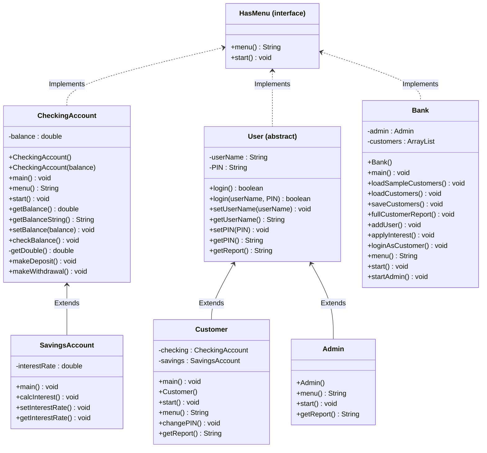

# CS121-Bank-on-it-Part-II-Project
## UML Class Diagram

## HasMenu 

```text
HasMenu
    - create interface HasMenu
    - String menu()
    - void start()
```

## CheckingAccount

```text
main()
    - create new CheckingAccount object
        - new CheckingAccount()
    - account.start()

CheckingAccount()
    - balance = 0

CheckingAccount(double balance)
    - this.balance = balance

getBalance()
    - return balance

getBalanceString()
    - return String.format("$%.2f", balance)

setBalance(double balance)
    - this.balance = balance

checkBalance()
    - print "Current balance: " + getBalanceString()

getDouble()
    - create Scanner input = new Scanner(System.in)
    - return input.nextDouble()

makeDeposit()
    - print "How much to deposit?"
    - amount = getDouble()

    - if amount > 0
        - balance = balance + amount
        - print "Deposit Successful"
    - else
        - print "Invalid Amount"

    - checkBalance()

makeWithdrawal()
    - print "How much to withdrawal?"
    - amount = getDouble()

    - if amount > 0 && amount <= balance
        - balance = balance - amount
        - print "Withdrawal Successful"
    - else
        - print "Invalid amount or not enough money"

    - print "new Balance: " + getBalanceString()

menu()
    - create Scanner input = new Scanner(System.in)
    - print "Account menu"
        - 0) quit
        - 1) check balance
        - 2) make a deposit
        - 3) make a withdrawal
    - print "Please enter 0-3:"
    - return input.next()

start()
    - choice = ""

    - while !choice.equals("0")
        - choice = menu()

        - if choice.equals("1")
            - checkBalance()
        - else if choice.equals("2")
            - makeDeposit()
        - else if choice.equals("3")
            - makeWithdrawal()
        - else if !choice.equals("0")
            - print "Invalid choice"
```

## SavingsAccount

```text
main()
    - create new SavingsAccount object
        - new SavingsAccount()
    - savings.start()

SavingsAccount()
    - interestRate = 0.05

calcInterest()
    - balance = getBalance()
    - interest = balance * interestRate
    - setBalance(balance + interest)

setInterestRate(double rate)
    - interestRate = rate

getInterestRate()
    - return interestRate
```

## User

```text
User()
    - userName = ""
    - PIN = ""

login()
    - create Scanner input = new Scanner(System.in)
    - print "User name:"
    - name = input.next()
    - print "PIN:"
    - pin = input.next()
    - return login(name, pin)

login(String userName, String PIN)
    - if this.userName.equals(userName) &&
         this.PIN.equals(PIN)
        - return true
    - else
        - return false

setUserName(String userName)
    - this.userName = userName

getUserName()
    - return userName

setPIN(String PIN)
    - this.PIN = PIN

getPIN()
    - return PIN

getReport()
    - abstract String method
    - implemented in Customer and Admin
```

## Customer

```text
main()
    - create new Customer object
        - new Customer()

    - if customer.login() == true
        - print "Login Successful"
        - customer.start()
    - else
        - print "Login Failed"

Customer()
    - checking = new CheckingAccount()
    - savings = new SavingsAccount()
    - setUserName("Alice")
    - setPIN("0000")

Customer(String userName, String PIN)
    - checking = new CheckingAccount()
    - savings = new SavingsAccount()
    - setUserName(userName)
    - setPIN(PIN)

getSavings()
    - return savings

setCheckingBalance(double balance)
    - checking.setBalance(balance)

setSavingsBalance(double balance)
    - savings.setBalance(balance)

menu()
    - create Scanner input = new Scanner(System.in)
    - print "Customer Menu"
        - 0) Exit
        - 1) Manage Checking Account
        - 2) Manage Savings Account
        - 3) Change PIN
    - print "Action (0-3):"
    - return input.next()

start()
    - choice = ""

    - while !choice.equals("0")
        - choice = menu()

        - if choice.equals("1")
            - print "Checking Account"
            - checking.start()
        - else if choice.equals("2")
            - print "Savings Account"
            - savings.start()
        - else if choice.equals("3")
            - changePIN()
        - else if choice.equals("0")
            - print "Have a great day"
        - else
            - print "Invalid choice"

changePIN()
    - create Scanner input = new Scanner(System.in)
    - print "Enter new PIN:"
    - newPIN = input.next()
    - setPIN(newPIN)
    - print "PIN Changed Successfully"

getReport()
    - report = "User: " + getUserName()
    - report = report + ", Checking: " + checking.getBalanceString()
    - report = report + ", Savings: " + savings.getBalanceString()
    - return report
```

## Admin

```text
Admin()
    - setUserName("admin")
    - setPIN("0000")

menu()
    - create Scanner input = new Scanner(System.in)
    - print "Admin Menu"
        - 0) Exit this menu
        - 1) Full customer report
        - 2) Add user
        - 3) Apply interest to savings accounts
    - print "Action:"
    - return input.next()

start()
    - empty method
    - Bank handles the admin menu

getReport()
    - return "Admin: " + getUserName()
```

## Bank

```text
main()
    - create new Bank object
        - new Bank()

Bank()
    - admin = new Admin()
    - customers = new CustomerList()
    - this.loadCustomers()
    - this.start()
    - this.saveCustomers()

menu()
    - create Scanner input = new Scanner(System.in)
    - print "Bank Menu"
        - 0) Exit system
        - 1) Login as admin
        - 2) Login as customer
    - print "Action:"
    - return input.next()

start()
    - keepGoing = true

    - while keepGoing
        - choice = menu()

        - if choice.equals("1")
            - print "Admin Login"
            - if admin.login() == true
                - print "Login Successful"
                - startAdmin()
            - else
                - print "Invalid Login"

        - else if choice.equals("2")
            - loginAsCustomer()

        - else if choice.equals("0")
            - print "Goodbye!"
            - keepGoing = false

        - else
            - print "Invalid choice"

startAdmin()
    - keepGoing = true

    - while keepGoing
        - choice = admin.menu()

        - if choice.equals("1")
            - fullCustomerReport()
        - else if choice.equals("2")
            - addUser()
        - else if choice.equals("3")
            - applyInterest()
        - else if choice.equals("0")
            - keepGoing = false
        - else
            - print "Invalid choice"

fullCustomerReport()
    - print "Full customer report"

    - for each customer in customers
        - print customer.getReport()

addUser()
    - create Scanner input = new Scanner(System.in)
    - print "Add User"
    - print "Name:"
    - name = input.next()
    - print "PIN:"
    - pin = input.next()

    - customer = new Customer(name, pin)
    - customer.getSavings().setInterestRate(0.05)
    - customers.add(customer)

    - print "Customer added"

applyInterest()
    - print "Apply interest"

    - for each customer in customers
        - customer.getSavings().calcInterest()

    - print "Interest applied"

loginAsCustomer()
    - create Scanner input = new Scanner(System.in)
    - print "User name:"
    - name = input.next()
    - print "PIN:"
    - pin = input.next()

    - found = false

    - for each customer in customers
        - if customer.login(name, pin) == true
            - found = true
            - print "Login Successful"
            - customer.start()
            - break

    - if found == false
        - print "Invalid Login"

loadSampleCustomers()
    - create Customer Alice with PIN "0000"
    - set Alice checking balance to 1000
    - set Alice savings balance to 1000
    - set Alice interest rate to 0.05

    - create Customer Bob with PIN "1111"
    - set Bob interest rate to 0.05

    - create Customer Cindy with PIN "2222"
    - set Cindy interest rate to 0.05

    - add Alice to customers
    - add Bob to customers
    - add Cindy to customers

saveCustomers()
    - try
        - create ObjectOutputStream
        - open "customers.dat"
        - write customers to file
        - close output
        - print "Customers saved"

    - catch IOException
        - print "Error saving customers"

loadCustomers()
    - file = new File("customers.dat")

    - if file.exists()
        - try
            - create ObjectInputStream
            - open "customers.dat"
            - read CustomerList from file
            - close input
            - print "Customers loaded"

        - catch Exception
            - print "Error loading customers"
            - print "Please check your saved data file."
            - exit program

    - else
        - loadSampleCustomers()
```
